# ambientCG: Surface Imperfections materials

**20 assets from [ambientCG](https://ambientcg.com), dedicated to the public domain under [CC0](https://docs.ambientcg.com/license/).** Use them in any game, free or paid, and change them however you like; no credit is needed.

PBR materials as 1K and 2K JPG maps (colour, normal GL and DX, roughness, AO, displacement), one folder per resolution. 480.5 MB in all.

This is a copy kept by [zuujis-cc0](https://github.com/zuujis-cc0) so game makers can take single files from GitHub. It is not made by or affiliated with ambientCG: the originals, often in more formats and higher resolutions, are on [ambientcg.com](https://ambientcg.com). If they help you, consider [supporting ambientCG](https://www.patreon.com/ambientCG).

Every file is listed in [MANIFEST.tsv](MANIFEST.tsv) with its size and SHA-256. More free assets: [the Zuujis collection](https://github.com/zuujis-cc0/free-game-assets#readme).

| | | | |
| :-: | :-: | :-: | :-: |
| <a href="SurfaceImperfections001">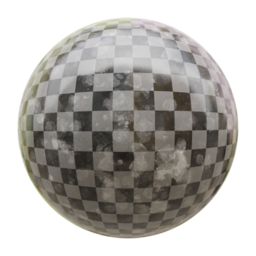</a> <b><a href="SurfaceImperfections001">Surface Imperfections 001</a></b> by ambientCG · <a href="https://ambientcg.com/a/SurfaceImperfections001">source</a> | <a href="SurfaceImperfections002">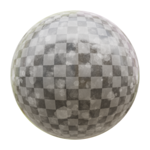</a> <b><a href="SurfaceImperfections002">Surface Imperfections 002</a></b> by ambientCG · <a href="https://ambientcg.com/a/SurfaceImperfections002">source</a> | <a href="SurfaceImperfections003">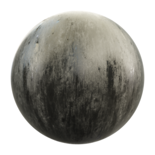</a> <b><a href="SurfaceImperfections003">Surface Imperfections 003</a></b> by ambientCG · <a href="https://ambientcg.com/a/SurfaceImperfections003">source</a> | <a href="SurfaceImperfections004">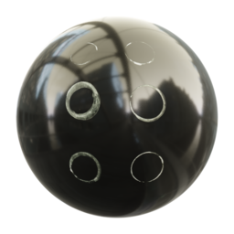</a> <b><a href="SurfaceImperfections004">Surface Imperfections 004</a></b> by ambientCG · <a href="https://ambientcg.com/a/SurfaceImperfections004">source</a> |
| <a href="SurfaceImperfections005">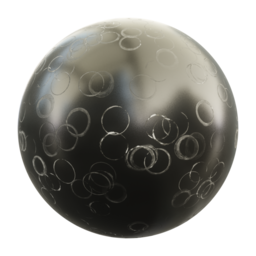</a> <b><a href="SurfaceImperfections005">Surface Imperfections 005</a></b> by ambientCG · <a href="https://ambientcg.com/a/SurfaceImperfections005">source</a> | <a href="SurfaceImperfections006">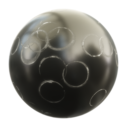</a> <b><a href="SurfaceImperfections006">Surface Imperfections 006</a></b> by ambientCG · <a href="https://ambientcg.com/a/SurfaceImperfections006">source</a> | <a href="SurfaceImperfections007">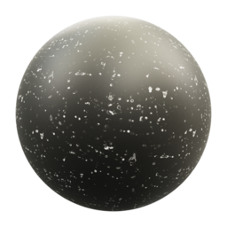</a> <b><a href="SurfaceImperfections007">Surface Imperfections 007</a></b> by ambientCG · <a href="https://ambientcg.com/a/SurfaceImperfections007">source</a> | <a href="SurfaceImperfections008">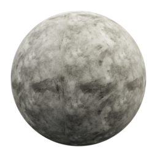</a> <b><a href="SurfaceImperfections008">Surface Imperfections 008</a></b> by ambientCG · <a href="https://ambientcg.com/a/SurfaceImperfections008">source</a> |
| <a href="SurfaceImperfections009">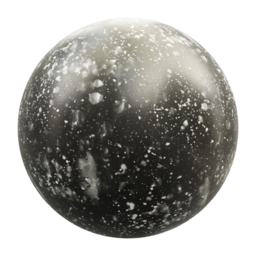</a> <b><a href="SurfaceImperfections009">Surface Imperfections 009</a></b> by ambientCG · <a href="https://ambientcg.com/a/SurfaceImperfections009">source</a> | <a href="SurfaceImperfections010">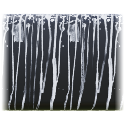</a> <b><a href="SurfaceImperfections010">Surface Imperfections 010</a></b> by ambientCG · <a href="https://ambientcg.com/a/SurfaceImperfections010">source</a> | <a href="SurfaceImperfections011">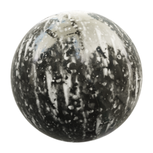</a> <b><a href="SurfaceImperfections011">Surface Imperfections 011</a></b> by ambientCG · <a href="https://ambientcg.com/a/SurfaceImperfections011">source</a> | <a href="SurfaceImperfections012">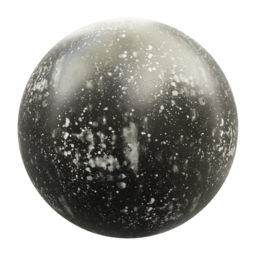</a> <b><a href="SurfaceImperfections012">Surface Imperfections 012</a></b> by ambientCG · <a href="https://ambientcg.com/a/SurfaceImperfections012">source</a> |
| <a href="SurfaceImperfections013">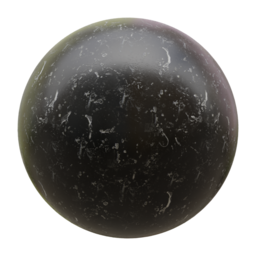</a> <b><a href="SurfaceImperfections013">Surface Imperfections 013</a></b> by ambientCG · <a href="https://ambientcg.com/a/SurfaceImperfections013">source</a> | <a href="SurfaceImperfections014">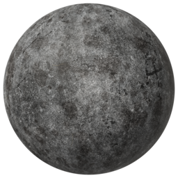</a> <b><a href="SurfaceImperfections014">Surface Imperfections 014</a></b> by ambientCG · <a href="https://ambientcg.com/a/SurfaceImperfections014">source</a> | <a href="SurfaceImperfections015">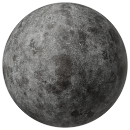</a> <b><a href="SurfaceImperfections015">Surface Imperfections 015</a></b> by ambientCG · <a href="https://ambientcg.com/a/SurfaceImperfections015">source</a> | <a href="SurfaceImperfections016">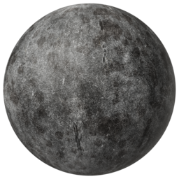</a> <b><a href="SurfaceImperfections016">Surface Imperfections 016</a></b> by ambientCG · <a href="https://ambientcg.com/a/SurfaceImperfections016">source</a> |
| <a href="SurfaceImperfections017">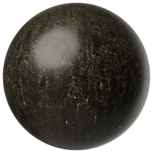</a> <b><a href="SurfaceImperfections017">Surface Imperfections 017</a></b> by ambientCG · <a href="https://ambientcg.com/a/SurfaceImperfections017">source</a> | <a href="SurfaceImperfections018">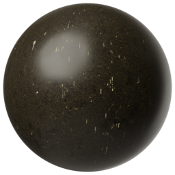</a> <b><a href="SurfaceImperfections018">Surface Imperfections 018</a></b> by ambientCG · <a href="https://ambientcg.com/a/SurfaceImperfections018">source</a> | <a href="SurfaceImperfections019">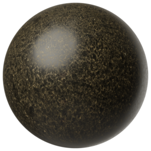</a> <b><a href="SurfaceImperfections019">Surface Imperfections 019</a></b> by ambientCG · <a href="https://ambientcg.com/a/SurfaceImperfections019">source</a> | <a href="SurfaceImperfections020">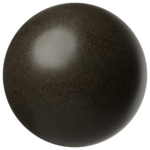</a> <b><a href="SurfaceImperfections020">Surface Imperfections 020</a></b> by ambientCG · <a href="https://ambientcg.com/a/SurfaceImperfections020">source</a> |

---

Kept up to date by this repository's own [update workflow](.github/workflows/update.yml), with code and plan from [cc0-mirror](https://github.com/zuujis-cc0/cc0-mirror). Something wrong? [Open an issue there](https://github.com/zuujis-cc0/cc0-mirror/issues/new) or use the [private report form](https://games.zuujis.com/report).
